<picture>
  <source media="(prefers-color-scheme: dark)" srcset="./dark.svg">
  <source media="(prefers-color-scheme: light)" srcset="./light.svg">
  
</picture>

I'm an engineering student at EMSI who builds full-stack applications with Java and JavaScript, from Spring Boot microservices to React and Next.js front ends, and ships them with Docker and CI/CD.

## Stack

| | |
|---|---|
| **Languages** | Java, Python, JavaScript, TypeScript, C++ |
| **Web and mobile** | Spring Boot, React, Next.js, Angular, Django, React Native, Flutter |
| **Data** | MongoDB, PostgreSQL, MySQL, SQL Server, Firebase |
| **DevOps and tools** | Docker, GitHub Actions, Linux, SonarQube, OWASP ZAP, Postman |

## Certifications

- Java SE 17 Developer, Oracle (2026)
- OCI DevOps Professional, Oracle (2026)
- Introduction to DevOps, IBM (2025)
- Containers with Docker, Kubernetes and OpenShift, IBM (2025)

## Contact

[Portfolio](https://saad-elmahi.netlify.app) · [LinkedIn](https://linkedin.com/in/saad-el-mahi) · saadelmahi123@gmail.com

<picture>
  <source media="(prefers-color-scheme: dark)" srcset="./heatmap-dark.svg">
  <source media="(prefers-color-scheme: light)" srcset="./heatmap-light.svg">
  
</picture>

